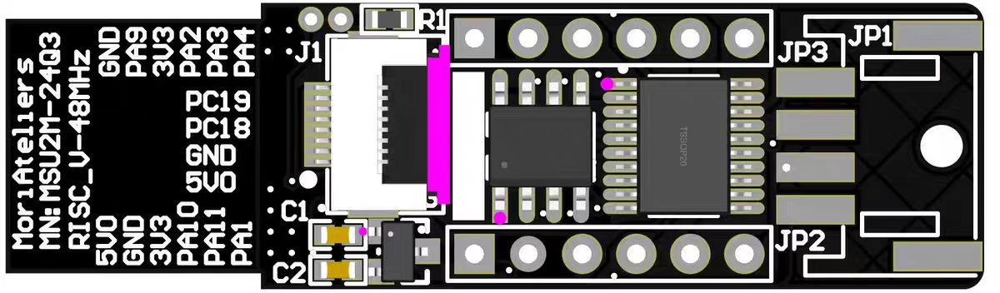

# Open_MSU2_MINI

MSU2_MINI 可编程 USB 屏幕模块的**硬件资料与接口规范**。

原厂（丝印 `Moriateliers` / `MN: MSU2M-2403`）承诺开源原理图与 PCB 文件，两年未兑现。本仓库是社区侧的重建：

- **硬件连线表**：根据实物照片、PCB 走线与固件行为（GPIO 复用寄存器写入序列）逐脚反推，见 [docs/PINOUT.md](docs/PINOUT.md)
- **通信协议规范**：根据固件实现与官方上位机双向对照整理，见 [docs/PROTOCOL.md](docs/PROTOCOL.md)
- **BOM 与选型说明**：见 [BOM.csv](BOM.csv)
- 本仓库**不含**原厂原理图 / PCB 源文件——这些从未公开，请勿向本项目索取

固件侧的反编译结果、分析方法与完整分析报告在另一个仓库：[MSU2_MINI_FW_Reverse](https://github.com/hsushjk/MSU2_MINI_FW_Reverse)。

---

## 硬件概况

| 项目 | 规格 |
|---|---|
| 主控 | CH32X033F8P6（QFN-20，RISC-V 青稞内核，48 MHz HSI，无外部晶振） |
| 程序存储 | 片内 64 KB Flash，本固件仅用 24 KB（0x0000–0x5E9F） |
| 内存 | 20 KB SRAM（固件栈顶 0x20005000，实测） |
| 外部存储 | P25D80H，1 MB SPI NOR Flash（SOP-8） |
| 显示屏 | 0.96 英寸，160×80，ST7735S，8-pin 0.5 mm FPC |
| 背光 | 5 V 经 R1（5.1 Ω）直接供电，**无开关管、无 PWM 调光** |
| 供电 | USB 5 V → XC6206P33 LDO → 3.3 V |
| USB | A 型插头直插；复合设备：CDC-ACM + HID |
| 交互 | 一个电容触摸焊盘；无按键、无复位键 |
| 尺寸 | 约 55 × 18 mm（贴片 USB 棒形态） |

屏与 flash 共用 SPI1：屏走 PC3 片选，flash 走 PB7 片选；这是理解整个板子的关键——**两根片选、一条总线**。

## 引脚连接（摘要）

完整表格（含复用冲突与固件访问次数）见 [docs/PINOUT.md](docs/PINOUT.md)。

| 脚 | 网络 | 功能 |
|---|---|---|
| PA6 | SPI_MISO | flash 数据输出 **兼** LCD D/C（一脚两用） |
| PA7 | SPI_MOSI | 屏与 flash 共用 |
| PA5 | SPI_SCLK | 屏与 flash 共用（固件跑 24 MHz，模式 3） |
| PB7 | SPI_CS_Flash | flash 片选 |
| PC3 | SPI_CS_LCD | 屏片选 |
| PA4 / PA1 | SPI_CS1 / SPI_CS2 | 引到排针，固件从不使用 |
| PA0 | LCD_RST | 屏复位 |
| PC16 / PC17 | USB D− / D+ | D+ 有 ISP 短接焊盘 |
| PB1 | Touch1 | 触摸焊盘 |
| PC18 / PC19 | I2C_DIO / I2C_CLK | 与 SWDIO/SWCLK 复用，JP1 引出 |
| PA2 / PA3 | TX2 / RX2 | USART2，调试串口（固件只发） |
| PA10 / PA11 | TX1 / RX1 | USART1，未使用 |
| PA9 | — | **空脚**，固件却翻转 28 次（幽灵片选） |

## 已知硬件设计问题

1. **PA6 一脚两用**（flash MISO + 屏 D/C）。这是全板最糟糕的设计：片选都拉高、总线空闲时，PA6 仍被 MCU 作为推挽输出驱动（D/C 电平），外挂 SPI 从机的数据线会被顶住。结论——板上那两组 SPI 排针**只能写，不能读**。
2. **PA9 空脚却有固件动作**。WCH 例程遗留的片选脚，硬件上没接任何东西，固件每次刷屏都翻转它 28 次，纯属时序噪声。
3. **背光不可调**。R1 直接串在 5 V 与背光灯之间，没有三极管/MOSFET，因此无法调光、无法关屏。注意 R1 = 5.1 Ω 偏小，**上电前请实测背光电流**，不同批次屏的正向压降不同。
4. **I2C 与调试口复用**。PC18/PC19 就是 SWDIO/SWCLK，接了 I2C 外设就失去调试能力，反之亦然；JP1 只有焊盘、默认不焊。
5. **没有复位键、没有 BOOT 键**。进入 USB ISP 只能在上电瞬间短接 `USB_D+ / 3.3V` 焊盘。该焊盘**不可常接**：MCU 使能 USB 后会推挽驱动 D+，常接等于和 3.3 V 电源对顶。
6. **丝印不带引脚名**。板上只有 `JP1/JP2/JP3/J1`，引脚功能全部靠本仓库的反推表。
7. flash 的 /WP 与 /HOLD 被硬接 3.3 V，写保护引脚形同虚设（对本用途无影响，但复刻时要知道）。

## 复刻建议

- **屏**：0.96" 160×80 ST7735S、8-pin FPC 的模组在电商平台可买到；买前确认 FPC 是**同向还是反向**接触、金手指间距 0.5 mm。这是复刻最大的坑。
- **FPC 座**：J1 为 8P 0.5 mm 翻盖式座（具体型号未公开，按屏排线厚度选）。
- **LDO**：XC6206P332MR（SOT-23），兼容替代 ME6206、HT7333。
- **背光**：若要做调光，把 R1 换成经 N-MOSFET 接地，栅极接 PA9（正好是那颗空脚），固件侧无需改现有代码即可复用。
- **触摸**：单焊盘电容触摸，靠 ADC 采样。焊盘形状与盖板厚度直接影响灵敏度，建议照抄照片里的圆形焊盘尺寸。

## 许可

本仓库文档与连线表采用 **MIT License**，见 [LICENSE](LICENSE)。

注意事项：

- 硬件事实（引脚、协议、元件值）是从实物与固件反推的，**不保证与原厂设计完全一致**；按此复刻的风险由使用者承担。
- "MSU2"、"Moriateliers" 等名称与商标归原厂所有，本项目与其无关联、未获授权。
- 硬件设计通常还涉及专利许可，MIT 只覆盖版权，不授予任何专利权利。